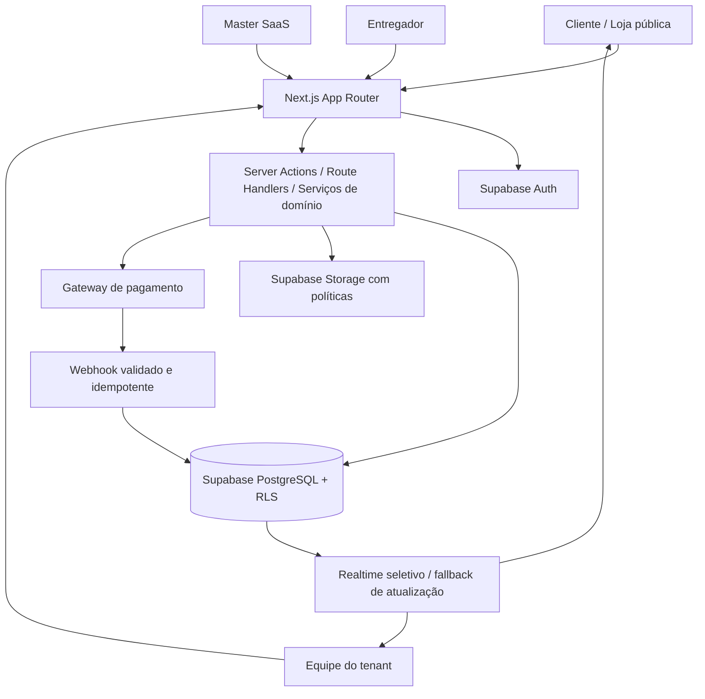

# Arquitetura do Sistema — Plataforma SaaS de Loja Virtual e Delivery

> **Status:** Proposta de arquitetura para homologação (não autoriza implementação automática)  
> **Versão:** 1.2  
> **Data:** 30/09/2026  
> **Produto SaaS:** nome comercial a definir  
> **Tenant pioneiro:** BENZA  
> **Stack-base:** Next.js (App Router), TypeScript, Tailwind CSS e Supabase (PostgreSQL, Auth, Storage e Realtime quando justificável).

## 1. Objetivo e princípios

Construir um **SaaS multi-tenant de presença digital, comércio eletrônico e delivery próprio** para estabelecimentos. Cada tenant terá sua loja institucional/comercial, identidade visual, catálogo, clientes, pedidos, estoque, pagamentos e operação logística. A **BENZA é o primeiro tenant**, não o nome nem uma regra fixa da plataforma. O sistema deve permitir comercialização a outras empresas com configurações independentes, sem copiar código ou criar um banco por cliente na primeira versão.

Princípios inegociáveis:

1. **Isolamento por tenant desde o banco:** nunca confiar apenas no filtro de interface.
2. **Configuração antes de customização:** particularidades da BENZA tornam-se módulos e opções reutilizáveis.
3. **Uma fonte de verdade para pedidos, estoque, pagamentos e entrega.**
4. **Separação financeira:** assinatura paga pelo tenant ao SaaS ≠ pagamento do consumidor ao estabelecimento.
5. **Operações auditáveis:** transições de estado, alterações de preço/estoque, pagamentos e confirmações de entrega devem deixar trilha.
6. **Mobile First e responsividade integral:** site institucional, loja, checkout, painéis e portal do entregador devem oferecer interfaces adequadas a smartphones, tablets e desktops; beleza e usabilidade são critérios de aceite, não melhorias opcionais.
7. **Presença institucional premium por tenant:** núcleo compartilhado e camada visual flexível, com identidade própria, composição editorial, conteúdo e temas sem duplicação de código.
8. **Lançamento incremental:** o primeiro release público será o site institucional BENZA em modo pré-lançamento, após homologar a fundação mínima e segurança; checkout só será ativado após testes próprios.
9. **SEO e aquisição orgânica como capacidade central do SaaS:** arquitetura técnica, conteúdo útil, SEO local, auditoria e monitoramento por tenant desde o primeiro release, sem prometer posições ou crescimento garantido.
10. **Não presumir regra fiscal, alimentar ou financeira universal:** campos configuráveis, revisão humana e validação das obrigações aplicáveis antes da operação.

### 1.1 Escopo inicial

- Site institucional e loja por tenant; modo pré-lançamento.
- SEO técnico e editorial nativo por tenant, auditoria pré-publicação, mensuração e integração opcional com ferramentas de busca e análise.
- Catálogo flexível (categoria, produto, variante, peso/unidade, adicionais opcionais), fotografia e ficha informativa.
- Carrinho, checkout como visitante, entrega/retirada, agenda e cálculo de taxa por área.
- Pagamento online por gateway com confirmação segura por webhook.
- Painel do tenant: produtos, pedidos, estoques, lotes opcionais, preparação, expedição, equipe, entregadores, ocorrências e indicadores.
- Acompanhamento do pedido e confirmação de entrega via código ao destinatário.
- Master: tenants, assinaturas, planos, direitos de acesso a funcionalidades, domínios e auditoria.

### 1.2 Fora do MVP / evolução posterior

Rastreamento GPS em tempo real, marketplace com recebimento financeiro centralizado e split, roteirização automática, emissão fiscal automática, integrações nativas com iFood/99Food/ERP, múltiplas unidades com estoque distribuído, programa de fidelidade avançado, automações de marketing em massa e aplicativo nativo. Prever pontos de extensão sem construir antecipadamente.

## 2. Atores e permissões

| Ator | Alcance | Atribuições principais |
|---|---|---|
| `platform_master` | SaaS | Tenants, planos, assinaturas, suporte controlado, configuração global, auditoria. |
| `tenant_admin` | Tenant | Configuração da loja, membros, catálogo, operação, relatórios e integrações. |
| `tenant_manager` | Tenant | Pedidos, produção, estoque e equipe, conforme permissões concedidas. |
| `production_operator` | Tenant | Etapas de produção atribuídas. |
| `dispatch_operator` | Tenant | Separação, embalagem, atribuição e despacho. |
| `courier` | Tenant | Somente entregas atribuídas, ocorrências e confirmação. |
| `customer` / visitante | Loja | Navegar, comprar e consultar somente seus pedidos por sessão/autenticação ou token seguro. |

Permissões são definidas por **papel + tenant + ação**; não basta ocultar botões. Um usuário pode pertencer a mais de um tenant com papéis distintos. O Master não herda acesso irrestrito a dados de consumidores das empresas; suporte excepcional deve ter justificativa, prazo e auditoria. Não expor `service_role` no navegador.

## 3. Arquitetura lógica



**Organização sugerida do repositório (ajustar após inspeção do workspace):**

```text
/docs/
  ARCHITECTURE.md
  SEO_STRATEGY.md                 # política, auditorias e KPIs de aquisição orgânica
  DESIGN_SYSTEM.md                # tokens, temas, variantes e UX responsiva
  DEVELOPMENT_PLAN.md             # a criar após homologação
  DATABASE.md                     # esquema detalhado e migrations
  SECURITY.md                     # matriz RLS e ameaças
  BUSINESS_RULES.md               # regras e estados
  INTEGRATIONS.md                 # gateways, domínios, notificações
  ADR/                            # registros das decisões arquiteturais
/src/app/
  (marketing)/                    # página comercial do SaaS, se adotada
  (storefront)/                   # loja pública resolvida pelo host
  (platform)/                     # master e gestão SaaS
  (tenant-admin)/                 # administração da empresa
  (courier)/                      # painel entregador
  api/webhooks/                   # endpoints autenticados por assinatura do provedor
/src/modules/
  tenancy/ site-builder/ theming/ seo/ catalog/ inventory/ checkout/ payments/
  orders/ fulfillment/ delivery/ customers/ billing/ reporting/
/src/lib/
  supabase/ auth/ permissions/ validation/ observability/
/supabase/migrations/
/tests/unit/ /tests/integration/ /tests/e2e/ /tests/security/
```

Separar interfaces de serviços de domínio; operações financeiras/estoque/transição de estado críticas ocorrem em funções transacionais no servidor/banco, não em múltiplas requisições frágeis do navegador. Não acoplar o núcleo a um provedor de pagamentos, serviço de comunicação ou entregador específico.

## 4. Resolução de tenant, rotas e personalização

- SaaS: `app.plataforma.com.br` e `master.plataforma.com.br` são **exemplos**, sujeitos à escolha do nome e domínio.
- Lojas: `slug.plataforma.com.br` e/ou domínio próprio verificado (ex.: `www.benza.com.br`).
- `tenant_domains` mantém host canônico, tipo, estado de verificação e relação tenant↔domínio. Host é normalizado, confrontado com allowlist/registro verificado e resolvido no servidor; não usar `tenant_id` fornecido pelo cliente como autoridade.
- Rotas de administração exigem sessão + associação ativa + permissão. Lojas suspensas mostram página apropriada sem revelar dados internos.
- `tenant_settings` guarda configurações operacionais e referências à identidade visual; conteúdo, tema, páginas, seções, revisões e publicação são entidades próprias de CMS. A configuração visual não concede permissões nem direitos de plano.
- Assets públicos e privados separados, com políticas de Storage. URLs de arquivos privados devem ser temporárias/autorizadas.
- O design da BENZA (terracota, mostarda/dourado e creme/marfim, logomarca fornecida) é uma configuração do Tenant 01, jamais padrão imposto a todos.

## 5. Modelo de dados conceitual

Todos os registros pertencentes a uma empresa carregam `tenant_id` explícito quando necessário. Usar UUIDs, timestamps com fuso (`timestamptz`), índices em `tenant_id` e chaves compostas/restrições que impeçam vínculo cruzado entre tenants. O modelo abaixo é um guia; o esquema físico, os índices e as migrations exigem revisão própria em `DATABASE.md`.

| Domínio | Entidades principais | Observações |
|---|---|---|
| Plataforma | `tenants`, `tenant_domains`, `tenant_settings`, `tenant_members`, `roles`, `permissions`, `audit_logs` | Identidade, domínio e autorização. |
| SaaS comercial | `plans`, `plan_features`, `subscriptions`, `subscription_invoices`, `tenant_feature_overrides` | Cobrança do estabelecimento pela plataforma. |
| Presença digital/CMS | `site_themes`, `site_pages`, `site_sections`, `site_media`, `site_publications` (nomes provisórios) | Configuração tipada, ordenação, visibilidade, versões de rascunho/publicadas e isolamento por tenant. |
| SEO e aquisição orgânica | `seo_settings`, `seo_page_metadata`, `seo_keyword_targets`, `seo_audit_runs`, `seo_audit_issues`, `seo_metric_snapshots`, `seo_redirects`, `seo_integrations` (nomes provisórios) | Tudo segregado por tenant, domínio e página; segredos de integrações protegidos; métricas históricas com fonte e intervalo. |
| Captação pré-lançamento | `site_leads`, `lead_consents` (nomes provisórios) | Cadastro opcional, proteção antispam, finalidade e registro de consentimento quando necessário. |
| Catálogo | `categories`, `products`, `product_variants`, `product_media`, `modifier_groups`, `modifiers`, `product_information` | Peso/unidade, preço por variante, informação alimentar quando aplicável. |
| Disponibilidade | `inventory_locations`, `inventory_lots`, `stock_movements`, `stock_reservations` | Lotes opcionais por tipo de operação; quantidade disponível não é campo livre sem conciliação. |
| Consumidores | `customers`, `customer_addresses`, `customer_tenant_links`, `customer_consents` | Segregar a relação comercial por tenant; coletar apenas dados necessários. |
| Vendas | `carts`, `cart_items`, `orders`, `order_items`, `order_status_events`, `order_adjustments` | Snapshot imutável de título, preço, tributos/taxas aplicáveis e variantes no fechamento. |
| Pagamentos das lojas | `merchant_payment_accounts`, `payment_intents`, `payment_transactions`, `payment_webhook_events`, `refunds` | Credenciais/segredos em cofre seguro, não em tabela pública. |
| Logística | `delivery_zones`, `delivery_windows`, `deliveries`, `delivery_assignments`, `delivery_events`, `delivery_proofs`, `delivery_incidents` | Janela, entregador, token de prova e ocorrências. |
| Comunicação | `notification_templates`, `notification_events`, `notification_preferences` | Mensagens transacionais; futuras integrações desacopladas. |

**Campos de referência importantes:** `orders`: tenant, número legível único por tenant, customer/guest, snapshot de endereço e itens, origem do canal, tipo (entrega/retirada), janela, totais, moeda, estado de pagamento e estado operacional separados. `inventory_lots`: produto/variante, lote, fabricação, validade, quantidade e situação. `order_status_events`: estado anterior, novo estado, autor, origem, horário e metadados seguros.

### 5.1 Integridade e concorrência

- Criar restrições de unicidade por tenant quando couber: `UNIQUE (tenant_id, slug)` e numeração de pedido própria.
- Validar parentesco tenant↔recurso por FK composta, políticas e/ou funções transacionais; testar tentativas de IDs cruzados.
- Reservation de estoque é atômica, com expiração controlada para checkout não concluído; conversão da reserva em baixa apenas uma vez.
- Valores monetários em centavos inteiros (ou `numeric` de precisão definida), sem `float`; cálculo final no servidor e snapshot no pedido.
- Nunca inferir pagamento confirmado por retorno do navegador. Eventos duplicados do webhook não podem duplicar pedido, estoque ou cobrança.

## 6. Regras de negócio

### 6.1 Catálogo e produtos

Produto e variante são separados. Cada variante pode representar 500 g, 1 kg, unidade, caixa ou combinação relevante. Modificadores permitem adicionais e personalização quando habilitados. Ficha pode incluir descrição, ingredientes, alergênicos, tabela nutricional validada, conservação e preparo. Informações obrigatórias dependem da categoria e da legislação aplicável; a plataforma fornece campos e aprovação, não inventa dados técnicos.

### 6.2 Modos comerciais

Tenant escolhe loja em `pre_launch`, `catalog_only`, `open`, `paused` ou `suspended_by_platform` (este último controlado pelo SaaS). Disponibilidade por produto, dias, horários, lead time, capacidade por janela, entrega/retirada e regiões atendidas. Checkout valida novamente preço, estoque, janela e endereço no servidor.

### 6.3 Estoque e congelados

Controle de estoque simples pode ser habilitado; modo avançado habilita localização, lote, fabricação, validade e FEFO (priorizar prazo de vencimento menor sob condições adequadas). O sistema não oferece lote vencido ou bloqueado. Registrar movimentos de entrada, reserva, baixa, ajuste e perda com autor e motivo. BENZA utiliza lote e entrega programada desde seu onboarding.

### 6.4 Máquina de estados: pedido e pagamento

**Separar estados de pagamento dos operacionais.** Estados sugeridos:

- Pedido: `draft` → `awaiting_payment` → `confirmed` → `in_fulfillment` → `ready_for_dispatch` → `out_for_delivery` → `delivered`; ramificações controladas para `cancelled`, `delivery_failed`, `returned`. Para retirada: `ready_for_pickup` → `picked_up`.
- Pagamento: `pending` → `authorized` (quando aplicável) → `paid`; alternativas `failed`, `expired`, `partially_refunded`, `refunded`, `chargeback`.
- Produção pode ser dispensada para itens já prontos em estoque; usar etapas configuráveis e eventos auditados. Nunca marcar `paid` a partir do clique do cliente.

### 6.5 Checkout e pagamentos

Fluxo: carrinho → validação servidor → reserva temporária → criação de pedido `awaiting_payment` → criação da cobrança na conta habilitada do tenant → webhook verificado, persistido e idempotente → `paid`/`confirmed` → início da operação. Em falha/expiração, liberar reserva de forma segura. Tratar reconciliação de eventos perdidos, reembolso e divergências. Integração inicial com um gateway a selecionar após avaliar requisitos técnicos, comerciais e de contas por estabelecimento. Não armazenar dados brutos de cartão; segredos apenas no servidor/cofre de segredos. Assinatura SaaS usa processo financeiro e identificadores separados dos pagamentos aos lojistas. Não fazer split/repasse centralizado no MVP.

### 6.6 Expedição e prova de entrega

Separar `separating`, `packed`, `awaiting_courier`, `out_for_delivery`, `delivered` como eventos/etapas configuráveis, preservando o estado principal do pedido. Entregador autenticado só vê atribuições suas e registra saída, tentativa, ocorrência ou entrega. Código aleatório de uso único para o destinatário, armazenado como hash, com validade e limite de tentativas; confirmação auditável com horário e responsável. Prever exceção supervisionada quando não for possível obter código, sem marcar entrega silenciosamente. O cliente vê status, janela e histórico por link assinado de alta entropia ou sessão autenticada, nunca por número de pedido isolado. GPS ao vivo fora do MVP.

## 7. Segurança, privacidade e operação

1. **RLS default-deny** para tabelas com dados de tenants e políticas baseadas em vínculo ativo e permissões; testar seleção, escrita, atualizações e exclusões entre tenants. Aplicar defesa em profundidade também em serviços privilegiados.
2. `platform_master` e suporte operam em backend controlado; ações elevadas registram ator, motivo e alvo. Jamais incluir chaves privilegiadas em bundle frontend.
3. Webhooks: verificar assinatura/mecanismo recomendado pelo fornecedor, armazenar ID do evento com unicidade, responder de forma segura e processar idempotentemente. Implementar reconciliação.
4. Rate limiting em login, consulta por token, cupons, checkout e verificação do código de entrega. Validar entradas com esquema tipado e registrar erros sem expor segredos ou dados pessoais.
5. Consentimentos e avisos específicos por tenant onde necessários, retenção/eliminação e exportação conforme exigências aplicáveis de privacidade e obrigações legais.
6. Backups, migrações reversíveis quando possível, observabilidade, monitoramento de filas/webhooks, alertas, ambientes separados (`dev`, `staging`, `production`) e plano de recuperação.
7. Não ativar recursos de produção sem testar fluxo ponta a ponta, callbacks, concorrência de estoque e falhas de rede.

## 8. Experiência e páginas

**Loja pública:** início, história/institucional, cardápio, detalhe do produto, carrinho, checkout, confirmação, acompanhamento, contato e páginas legais. O tema e o conteúdo são do tenant. Fotos reais dos produtos quando disponíveis; materiais de pré-lançamento não devem sugerir fotografia autêntica de produto inexistente.

**Admin tenant:** visão geral, identidade/site, categorias/produtos, estoque/lotes, pedidos, produção, expedição, entrega/entregadores, clientes, financeiro de vendas, relatórios, equipe, configurações de horário/frete/pagamento e auditoria autorizada.

**Portal do entregador:** login, minhas entregas, detalhes estritamente necessários, registrar saída, ocorrência e entrega/código.

**Master SaaS:** tenants, onboarding, planos/recursos, assinaturas/cobrança SaaS, domínios, monitoramento, auditoria e suporte controlado. Indicadores agregados minimizados conforme finalidade.

### 8.1 Princípio de experiência visual premium por tenant

O storefront **não será um template genérico com simples troca de logotipo**. O núcleo funcional é reutilizável, enquanto a camada de apresentação cria sites institucionais atraentes e de identidade reconhecível. A plataforma deverá oferecer componentes de alta qualidade, com curadoria visual e flexibilidade controlada, sem aceitar HTML/JavaScript arbitrário inserido pelo tenant.

- Arquitetura de **core separado da presentation layer**: dados/serviços de domínio não dependem do tema visual; temas e layouts não contêm regras de autorização, preço ou pagamento.
- **Design tokens por tenant**: cores semânticas, tipografia dentre opções licenciadas/aprovadas, escala de espaçamento, cantos, botões e estilos de imagem, com contrastes e estados acessíveis.
- **Biblioteca de seções tipadas** e variantes projetadas: hero editorial/minimalista, manifesto/história, vitrine de produtos, diferenciais, como funciona, galeria, FAQ, depoimentos verificados, CTA e contato. Nem todas precisam ser construídas no primeiro release.
- CMS para ativar/desativar, ordenar, editar conteúdo, pré-visualizar por dispositivo e publicar as seções permitidas pelo plano. Validar schemas e permitir somente componentes previamente homologados, sem comprometer layout, segurança ou desempenho.
- Rascunho e versão publicada independentes; publicação atômica, histórico de revisões e possibilidade de reverter alterações de conteúdo. O site publicado não deve exibir edições em andamento.
- Mesmo motor permite experiências distintas (ex.: BENZA editorial e uma confeitaria delicada) sem copiar páginas, aplicar condicionais pelo nome do tenant ou impor cores BENZA à plataforma.
- Fotografia real é prioritária para produtos finais; material ilustrativo deve ser identificado quando empregado e não deve representar como real um produto ainda não fotografado.

### 8.2 Mobile First e experiência responsiva — requisito transversal

Projetar primeiro para tela pequena e ampliar progressivamente para tablet e desktop. **Mobile First não equivale a esconder conteúdo importante no celular:** manter navegação, comunicação e capacidade de compra em todas as resoluções. Aplica-se ao site institucional, loja, checkout, acompanhamento, administração Master/tenant e portal do entregador.

| Superfície | Exigência principal |
|---|---|
| Institucional | Hero com recorte de imagem dedicado ao mobile, texto legível, menu adaptado, seções fluidas e CTAs evidentes. |
| Catálogo e produto | Grade responsiva, fotos proporcionais, variantes e informações alimentares acessíveis sem zoom. |
| Carrinho e checkout | Formulários adequados ao toque/autopreenchimento, resumo claro, mensagens de validação e ações acessíveis. |
| Acompanhamento | Linha de status e atualizações compreensíveis em smartphone, sem depender exclusivamente de cor ou animação. |
| Admin tenant/Master | Navegação recolhível, tabelas convertidas em cartões/listas ou rolagem contida quando apropriado; nenhuma ação crítica exclusiva de desktop. |
| Entregador | Interface prioritariamente mobile, botões grandes, poucos passos e confirmação com tratamento de falhas de conexão. |

Critérios não negociáveis:

1. Layout sem estouro ou rolagem horizontal **indevida**; testar larguras de referência 320, 360, 390, 768, 1024 e 1440 px e dispositivos/navegadores reais ou emulados. Esses valores são pontos de teste, não breakpoints rígidos de implementação.
2. Áreas de toque adequadas, navegação por teclado, foco visível, contraste e semântica; adotar **WCAG 2.2 AA** como meta e documentar eventuais desvios.
3. Fontes fluidas e legíveis, hierarquia consistente, imagens adaptativas (`next/image` quando aplicável), formatos modernos e carregamento seletivo; reservar dimensões para prevenir saltos de layout.
4. SEO técnico por tenant, metadados/OG, sitemap e canonical coerentes com domínio, status de publicação e páginas indexáveis; modo pré-lançamento não deve expor checkout ou páginas privadas.
5. Medir Core Web Vitals em produção (LCP, INP e CLS) e estabelecer metas e orçamento de desempenho em `DESIGN_SYSTEM.md`/`DEVELOPMENT_PLAN.md`; não prometer pontuação sem medição.
6. PWA **progressiva e opcional**: manifest, ícones e instalação quando fizer sentido; não pressupor notificações push, pagamentos ou entrega funcional offline. O fluxo crítico requer conexão e estados de falha explícitos.
7. Homologar cada tela em mobile, tablet e desktop antes de concluir sua sprint, inclusive orientação, teclado virtual, formulários, textos longos, estados vazios, erros e carregamento lento.

### 8.3 Etapa 1 pública: institucional BENZA, sem loja prematura

Após a Sprint 0 documental e a fundação técnica mínima de multi-tenancy/RLS/host resolution, publicar o **site institucional funcional da BENZA** como primeiro release público. Inclui página inicial, história/essência, vitrine e fichas informativas dos produtos efetivamente aprovadas, contato/Instagram/WhatsApp, páginas legais aplicáveis, fundação de SEO técnico/editorial, auditoria pré-publicação, captação opcional de interessados e CMS de conteúdo/tema com prévia e publicação. Usar logomarca oficial, cores terracota/mostarda/creme, fotografia própria quando disponível e composição premium/editorial responsiva.

- Estado `pre_launch`: apresentar lançamento e produtos aprovados, mas **sem carrinho, cobranças ou confirmação enganosa de pedidos**; CTAs apontam para contato ou aviso de novidades.
- A publicação institucional não depende de módulos futuros de estoque transacional, gateway ou entregas; estes permanecem desabilitados por feature flags/autorização no servidor.
- A primeira release exige domínio e HTTPS, isolamento entre pelo menos BENZA e tenant de teste, validação de segurança do CMS, teste de formulário/contato, acessibilidade e responsividade, monitoramento, backup e procedimento simples de reversão.
- Mudanças futuras na plataforma devem preservar o site institucional já publicado. Habilitar loja apenas com homologação completa do fluxo comercial correspondente.

### 8.4 SEO nativo e marketing de aquisição orgânica — requisito transversal

**Objetivo:** fornecer a cada tenant fundamentos técnicos e editoriais para ser encontrado em mecanismos de busca (incluindo Google), atrair tráfego qualificado e medir sua conversão em contatos e vendas. SEO não será reduzido a um campo de meta description, nem será apresentado como uma fórmula de pontuação garantida: sistemas de busca utilizam diversos sinais dinâmicos e não divulgam uma lista fixa ou pesos exatos. Não prometer primeira posição, indexação obrigatória, volume de vendas ou crescimento de 100%; permitir que o tenant configure metas como `+100% de leads orgânicos`, com baseline, período, amostra e atribuição definidos.

**A. SEO técnico por domínio e página**

1. Rotas legíveis e persistentes, slugs únicos por tenant, redirecionamento 301 para alterações de URL, prevenção de links quebrados, canonical absoluto coerente com o host público verificado; decidir URL canônica entre domínio próprio e subdomínio e evitar duplicação indexável. Se múltiplos domínios apontarem à mesma loja, definir redirecionamento/canonical estável.
2. Renderização de conteúdo institucional e comercial relevante no HTML inicial via Server Components/SSR/SSG/ISR, conforme o caso; conteúdo essencial não depende apenas de interação JavaScript ou autenticação. Configurar `generateMetadata`, `sitemap.ts`, `robots.ts`, metadados Open Graph e imagem de compartilhamento por tenant.
3. Sitemap XML por domínio apenas com URLs públicas, canônicas, publicadas e elegíveis; noindex para rascunhos, preview, páginas internas, carrinho, checkout, conta e acompanhamento privado. Não bloquear inadvertidamente páginas que se pretende indexar. Pré-lançamento: indexar apenas o conteúdo público de qualidade aprovado; decidir caso a caso sobre páginas de produtos ainda não lançados.
4. HTML semântico: um H1 principal claro por página, estrutura H2/H3 lógica, `title` específico, descrições informativas, URLs descritivas, breadcrumbs quando pertinentes; navegação e links internos rastreáveis com texto âncora claro. Não usar repetição artificial de termos ou metas arbitrárias de densidade de palavras-chave.
5. Dados estruturados JSON-LD compatíveis com conteúdo visível e testados: `Organization`/`LocalBusiness` quando aplicável, `BreadcrumbList`, `Product`/`Offer` em páginas comerciais elegíveis, e outros tipos apenas quando sustentados pelo conteúdo e pelas diretrizes atuais do mecanismo. Preço e disponibilidade devem refletir o banco, sem afirmar ratings/depoimentos inventados; rich results não são garantidos.
6. Performance e experiência: imagens responsivas e comprimidas com tamanho definido e texto alternativo útil, lazy loading seletivo (não prejudicar imagem LCP), fontes otimizadas, cache adequado, menos JavaScript desnecessário e monitoramento real de LCP, INP e CLS por dispositivo e página. Manter Mobile First, acessibilidade e segurança.
7. Monitorar 404, 5xx, ciclos de redirecionamento, canonicals conflitantes, bloqueios de robots, duplicação, links quebrados, mudanças de slug/domínio e problemas de indexação. Mudanças de tema/CMS não podem apagar metadados ou degradar a rastreabilidade.

**B. SEO editorial e pesquisa de intenção**

- CMS com keyword principal e termos relacionados como campos de planejamento (nunca requisitos mecânicos de repetição), intenção de busca, público/localidade, título SEO, descrição, H1, subtítulos, resumo, alt text, links internos, CTA, autor/revisor e data de atualização quando pertinente.
- Pesquisa e mapeamento de palavras-chave por clusters: marca, produtos/categorias, necessidade do cliente, localidade e conteúdo informativo. Registrar volume/dificuldade apenas se provenientes de fonte externa identificada, sem inventar estimativas.
- Conteúdo original, preciso, útil e revisado; evitar páginas massificadas quase idênticas para cada cidade/produto, textos artificiais para manipular buscadores, alegações sem fundamento ou publicação automática de artigos sem revisão.
- Suporte posterior a guias, artigos, FAQ editorial e páginas de campanha quando houver capacidade real de manter conteúdo de qualidade. Relacionar artigos relevantes com categorias e produtos por links internos contextuais.
- SEO local para estabelecimentos elegíveis: nome comercial, área atendida, horário, contato e informações consistentes no site; orientar configuração de Perfil da Empresa no Google fora do SaaS, com responsabilidade e acesso da empresa. Não inventar endereço físico nem aplicar marcação local em negócio que não se enquadre.

**C. Auditoria SEO e assistente de recomendações por tenant**

- Auditoria inicial antes de publicar uma página e auditorias periódicas sob demanda/agendadas. Registrar instantâneo com data, versão de conteúdo, URL, domínio, dispositivo, origem da medição e histórico de correções.
- Verificar ausência/duplicidade de titles, meta descriptions, H1, alt text relevante, páginas órfãs, URLs, redirecionamentos, links internos quebrados, canonical, robots, sitemap, dados estruturados, desempenho, mobile, contraste básico e situações de conteúdo raso/duplicado sujeitas a revisão humana.
- Painel de problemas com severidade `crítico`, `alto`, `médio`, `baixo`, explicação, impacto potencial, ação sugerida, responsável, status e botão para abrir a configuração da página. Diferenciar falha determinística de sugestão editorial heurística.
- Exibir checklist de publicação com bloqueadores técnicos configurados e avisos não bloqueantes. Um indicador interno de completude pode ajudar o fluxo de trabalho, mas **não** deve ser chamado de nota de ranking Google ou promessa de resultado.
- Fazer recomendações sem alterar conteúdo público automaticamente. Toda edição passa pelo fluxo de rascunho, prévia e publicação do CMS, com trilha de auditoria.

**D. Monitoramento, métricas, conversão e privacidade**

- Painel por tenant e domínio: impressões, cliques, CTR e posição média **quando conectados e disponibilizados pelo Search Console**; sessões/usuários e eventos/conversões com fonte de aquisição **quando houver integração analítica válida**. Não confundir cliques, visitas, leads, pedidos e receita.
- Definir conversões: clique qualificado no contato (indicador intermediário), formulário válido, início de checkout, pedido confirmado e compra paga; medir vendas orgânicas com modelo de atribuição e limitações explicitados. Prever parâmetros UTM para campanhas sem classificá-las automaticamente como orgânicas.
- Comparativos por período com baseline, tendência, páginas de entrada, termos de consulta quando disponibilizados, páginas com queda e oportunidades. Indicadores de posição média não equivalem a posição fixa para todos os usuários.
- Integrações opcionais: Google Search Console e GA4 com conexão autorizada por tenant; credenciais/tokens em armazenamento protegido, escopos mínimos, revogação, limites de API, logs de sincronização e isolamento. O SaaS deve funcionar sem conexão Google; nunca apresentar números simulados como reais.
- Consentimento e transparência de cookies/analytics conforme necessidade e legislação aplicável; não coletar informações pessoais desnecessárias, não transmitir tokens privados, dados de pedidos ou dados sensíveis a ferramentas analíticas. Relatórios agregados do Master devem respeitar contratos, finalidades e isolamento.

**E. Entrega incremental e critérios de aceite**

- **Release Público 1 (BENZA):** pesquisa inicial de termos e intenção, títulos/metadados próprios, conteúdo aprovado, headings semânticos, links internos, URLs/canonical, domínio HTTPS, sitemap/robots corretos, JSON-LD aplicável, Open Graph, imagens otimizadas, responsividade, auditoria inicial e instruções para conectar Search Console. Sem páginas genéricas indexáveis para o Tenant 02 de teste. A configuração/indicadores não devem depender do checkout futuro.
- **Evolução SaaS:** painel de auditoria com histórico, editor de recomendações, conectores Search Console/GA4, relatórios de leads/vendas atribuíveis e conteúdo editorial avançado. Priorizar fundação correta antes de construir automação extensa.
- Testes: domínio BENZA não gera sitemap, canonical, metadados, indicadores nem credenciais do Tenant 02; preview/admin privados não são indexáveis; redirecionamento de slug preserva destino; remoção/despublicação atualiza sitemap; structured data corresponde ao conteúdo e ofertas reais; auditoria identifica falhas plantadas; desempenho medido, não estimado.

**Referências normativas e de implementação (verificar versões vigentes antes da codificação):**
- [Google Search Essentials e guia de SEO](https://developers.google.com/search/docs/fundamentals/seo-starter-guide?hl=pt-BR)
- [Conteúdo útil para pessoas](https://developers.google.com/search/docs/fundamentals/creating-helpful-content)
- [Como a Pesquisa funciona](https://developers.google.com/search/docs/fundamentals/how-search-works)
- [Dados estruturados para produtos](https://developers.google.com/search/docs/appearance/structured-data/merchant-listing)
- [Métricas Core Web Vitals](https://web.dev/articles/vitals)

## 9. BENZA: configuração inicial do Tenant 01

- Identidade: marca oficial fornecida; paleta terracota, mostarda/dourado e creme/marfim. Não recriar a logo nem substituí-la por monograma.
- Publicação inicial: `pre_launch` com site institucional; habilitar compras após homologação.
- Catálogo inaugural: feijoada e lasanha, variantes planejadas de 500 g e 1 kg. Sem impor essas categorias ao núcleo SaaS.
- Operação planejada: produção no início da semana; vendas/entregas inicialmente de quinta a domingo, com janelas configuráveis e possibilidade de alteração.
- Controle avançado: lote, fabricação, validade, informações de conservação, disponibilidade e entrega programada.
- Embalagem, ficha técnica, preço, informações nutricionais, custo de frete e cobertura devem ser cadastrados/validados antes de abrir vendas.

## 10. Plano de sprints e portas de aprovação

| Sprint | Entrega | Critério de homologação essencial |
|---|---|---|
| 0 — Fundação documental | Arquitetura, ERD, matriz de acesso, jornadas e ADRs | Revisão humana; nenhuma migration sem aprovação. |
| 1 — Núcleo multi-tenant | Tenants, membros, RBAC/RLS, host resolution, configuração, Master mínimo | Testes cruzados de isolamento entre Tenant 01 e Tenant 02. |
| 2 — Institucional premium e **Release Público 1** | Design system/temas, CMS, páginas BENZA, modo pré-lançamento, domínio/HTTPS, SEO nativo, auditoria e formulário opcional | BENZA publicada e responsiva; segundo tenant com outra identidade; segurança, acessibilidade e publicação validadas; nenhum checkout exposto. |
| 3 — Catálogo e estoque | Produtos, variantes, informações, lotes e reservas | Preço/estoque correto sob pedidos concorrentes. |
| 4 — Carrinho e checkout | Carrinho, endereço, janela, cálculo de entrega, pedido | Validações no servidor; não venda sem disponibilidade. |
| 5 — Pagamentos | Gateway, webhook, ledger de eventos transacionais e reconciliação | Pagamento duplicado/perdido/falho sem baixa dupla. |
| 6 — Operação | Fila de pedidos, etapas de produção, embalagem e expedição | Transições válidas e trilha auditável. |
| 7 — Delivery | Atribuição, portal do entregador, confirmação por código | Entregador isolado, código único, ocorrência tratada. |
| 8 — Cliente e lançamento | Acompanhamento, notificações, relatórios básicos, E2E e checklist | Compra integral testada em BENZA e Tenant 02. |
| 8A — Monitoramento SEO avançado | Conectores opcionais Search Console/GA4, relatórios de aquisição, histórico de auditorias e recomendações | Consentimento/credenciais seguros; dados segregados; indicadores com fonte, janela e limitações; sem travar o site institucional ou a loja. |
| 9 — Comercialização SaaS | Planos, direitos, cobrança SaaS, onboarding e documentação | Novo cliente configurado sem mudança no código. |

**Regra de processo:** cada sprint começa com escopo/critérios de aceite aprovados e encerra com evidências de teste, migrations versionadas e documentação atualizada. Não misturar refatorações oportunistas com funcionalidades homologadas. Toda mudança relevante gera ADR e atualização deste documento.

## 11. Testes de aceitação transversais

- Usuário da BENZA tenta ler/alterar produto, pedido, cliente, comprovante ou arquivo do Tenant 02 → bloqueado no banco/API.
- Um usuário com papéis distintos em dois tenants recebe exatamente o acesso do tenant ativo.
- Dois consumidores disputam a última unidade → no máximo um confirma a reserva/venda.
- Webhook repetido ou fora de ordem → processamento idempotente, sem duplicar baixa ou status.
- Pagamento recusado/expirado → pedido não entra em produção e estoque é liberado no prazo definido.
- Loja `pre_launch` permite navegação institucional e bloqueia compra; loja `paused` informa indisponibilidade.
- Produto congelado com lote vencido/bloqueado → não disponível para venda.
- Entregador A não acessa entrega atribuída ao entregador B; confirmação requer prova válida ou exceção auditada.
- Consulta de pedido por número previsível sem sessão/token → negada.
- Tenant 02 é implantado com outra identidade visual e regras de produto, sem condicionais específicas para BENZA.
- O SEO da BENZA tem metadados, sitemap, canonical, robots, dados estruturados aplicáveis e auditoria sem vazamento para o Tenant 02; páginas privadas não são indexáveis.
- Páginas institucionais de BENZA e Tenant 02 são visualmente distintas, passam por teste de mobile/tablet/desktop (320–1440 px) e mantêm navegação, contraste e ações funcionais.
- Alterar um rascunho do CMS não altera a versão publicada; rollback de conteúdo preserva o site público.
- Release Público 1: domínio/HTTPS, metadados exclusivos, canonical/sitemap/robots corretos, auditoria SEO inicial sem bloqueadores críticos, contatos e formulário opcional operantes; não há acesso a carrinho/checkout/pagamento enquanto desabilitados no servidor.

## 12. Decisões pendentes (não assumir sem homologação)

1. Nome e domínio comercial do SaaS; política de domínio próprio e DNS.
2. Gateway inicial, condições de contas individuais e assinaturas SaaS.
3. Política de preço, quotas, módulos por plano e limites de uso.
4. Entrega própria versus terceiros; faixas de frete, regiões, horários e conservação térmica.
5. Regras de cancelamento, estorno, ausência do destinatário e confirmação excepcional.
6. Formato dos dados alimentares e processo humano para validar fichas e rótulos.
7. Retenção de pedidos, logs e informações dos consumidores; documentação legal e fiscal aplicável.
8. Estratégia de notificações (e-mail/WhatsApp/SMS), consentimentos e custo por envio.
9. Critérios da integração Search Console/GA4, política de consentimento, prioridade de SEO local e metas orgânicas por tenant.
10. Controles de múltiplas unidades, integrações externas e modalidade de retirada: preparado para extensão, sem promessa no MVP.

## 13. Instrução permanente ao agente de desenvolvimento

Leia este arquivo e o `DESIGN_SYSTEM.md`/`SEO_STRATEGY.md` (quando criados) antes de propor ou implementar qualquer funcionalidade. Confirme coerência com o isolamento multi-tenant, as regras de negócio e o plano de sprint vigente. Se um pedido de mudança contradizer uma decisão deste documento, sinalize o conflito, proponha uma ADR e solicite homologação antes de alterar o comportamento. Não execute migrations destrutivas nem desabilite RLS/testes para contornar erros. A BENZA é um tenant de referência, não uma exceção arquitetural. Documente novas tabelas, endpoints, permissões, estados, integrações e critérios de aceite antes da implementação correspondente.
