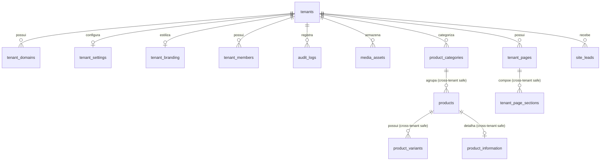

# Especificação de Banco de Dados — Plataforma SaaS Multi-Tenant

> **Status:** Homologado para implementação  
> **Versão:** 1.0  
> **Data:** 30/09/2026  
> **Banco:** Supabase PostgreSQL 15+

---

## 1. Princípios de Modelagem

1. **Isolamento de Dados Obrigatório:**
   - Toda entidade pertencente a um estabelecimento possui a coluna `tenant_id uuid NOT NULL REFERENCES tenants(id) ON DELETE CASCADE`.
2. **Integridade Referencial Cross-Tenant (Composite Foreign Keys):**
   - Para impedir que um recurso do Tenant A seja associado acidental ou maliciosamente a um recurso do Tenant B, todas as tabelas filhas utilizam chaves compostas `(tenant_id, id)` com constraint `UNIQUE`, e as chaves estrangeiras referenciam o par `(tenant_id, parent_id)`.
3. **Imutabilidade de Auditoria:**
   - A tabela `audit_logs` é estritamente *append-only*. Nenhuma operação de `UPDATE` ou `DELETE` é permitida via políticas RLS e triggers de banco.
4. **Armazenamento Estruturado de Mídia:**
   - A tabela `media_assets` armazena `bucket`, `storage_path`, `original_filename`, `mime_type`, `byte_size`, `width`, `height` e `alt_text`, permitindo URLs assinadas ou públicas sem acoplamento a um domínio estático.
5. **Catálogo Parametrizado:**
   - Variações de produto suportam unidades de medida configuráveis (`unit_type`: `ml`, `l`, `g`, `kg`, `un`, `cx`, `portion`, etc.) e `unit_value` numérico.

---

## 2. Diagrama de Relacionamento (Mermaid)

---

## 3. Dicionário de Dados — Tabelas da Etapa 1

### 3.1 Núcleo e Administração

#### `tenants`
| Coluna | Tipo | Modificadores | Descrição |
|---|---|---|---|
| `id` | `uuid` | `PRIMARY KEY DEFAULT gen_random_uuid()` | Identificador universal do tenant |
| `name` | `varchar(150)` | `NOT NULL` | Nome comercial da empresa |
| `slug` | `varchar(60)` | `NOT NULL UNIQUE` | Identificador na URL (ex: `benza`) |
| `status` | `varchar(20)` | `NOT NULL DEFAULT 'active'` | `'active'`, `'suspended'`, `'cancelled'` |
| `site_mode` | `varchar(20)` | `NOT NULL DEFAULT 'prelaunch'` | `'prelaunch'`, `'live'` |
| `created_at` | `timestamptz` | `NOT NULL DEFAULT now()` | Registro de criação |
| `updated_at` | `timestamptz` | `NOT NULL DEFAULT now()` | Última atualização |

#### `tenant_domains`
| Coluna | Tipo | Modificadores | Descrição |
|---|---|---|---|
| `id` | `uuid` | `PRIMARY KEY DEFAULT gen_random_uuid()` | Identificador do domínio |
| `tenant_id` | `uuid` | `NOT NULL REFERENCES tenants(id) ON DELETE CASCADE` | Tenant proprietário |
| `hostname` | `varchar(255)` | `NOT NULL UNIQUE` | Host normalizado (ex: `benza.com.br`) |
| `is_primary` | `boolean` | `NOT NULL DEFAULT false` | Indica se é o domínio canônico |
| `is_verified` | `boolean` | `NOT NULL DEFAULT true` | Estado de verificação de propriedade |
| `created_at` | `timestamptz` | `NOT NULL DEFAULT now()` | Data de registro |

#### `tenant_settings`
| Coluna | Tipo | Modificadores | Descrição |
|---|---|---|---|
| `tenant_id` | `uuid` | `PRIMARY KEY REFERENCES tenants(id) ON DELETE CASCADE` | 1:1 com tenant |
| `contact_email` | `varchar(255)` | `NULL` | E-mail de atendimento |
| `contact_phone` | `varchar(30)` | `NULL` | Telefone comercial |
| `contact_whatsapp` | `varchar(30)` | `NULL` | WhatsApp para suporte |
| `instagram_handle` | `varchar(100)` | `NULL` | Perfil sem @ |
| `address_summary` | `text` | `NULL` | Endereço ou região de atuação |
| `prelaunch_banner_text`| `text` | `NOT NULL DEFAULT 'Em breve'` | Mensagem no topo em modo pré-lançamento |
| `prelaunch_cta_text`   | `varchar(80)` | `NOT NULL DEFAULT 'Em breve'` | Rótulo do botão nos produtos/hero |
| `business_hours` | `jsonb` | `NOT NULL DEFAULT '{}'` | Horários de funcionamento |
| `seo_defaults` | `jsonb` | `NOT NULL DEFAULT '{}'` | Metadados globais de fallback |
| `created_at` | `timestamptz` | `NOT NULL DEFAULT now()` | Data de criação |
| `updated_at` | `timestamptz` | `NOT NULL DEFAULT now()` | Data de modificação |

#### `tenant_branding`
| Coluna | Tipo | Modificadores | Descrição |
|---|---|---|---|
| `tenant_id` | `uuid` | `PRIMARY KEY REFERENCES tenants(id) ON DELETE CASCADE` | 1:1 com tenant |
| `logo_media_id` | `uuid` | `NULL REFERENCES media_assets(id)` | Asset da logomarca |
| `favicon_media_id` | `uuid` | `NULL REFERENCES media_assets(id)` | Asset do favicon |
| `font_family_heading` | `varchar(80)` | `NOT NULL DEFAULT 'Inter'` | Família tipográfica dos títulos |
| `font_family_body` | `varchar(80)` | `NOT NULL DEFAULT 'Inter'` | Família tipográfica de corpo |
| `color_primary` | `varchar(30)` | `NOT NULL DEFAULT '#A84B2C'` | Cor primária (ex: terracota) |
| `color_secondary` | `varchar(30)` | `NOT NULL DEFAULT '#D99B26'` | Cor secundária (ex: mostarda) |
| `color_accent` | `varchar(30)` | `NOT NULL DEFAULT '#2C1A14'` | Cor de contraste/destaque |
| `color_background` | `varchar(30)` | `NOT NULL DEFAULT '#FDFBF7'` | Fundo claro/creme |
| `color_surface` | `varchar(30)` | `NOT NULL DEFAULT '#FFFFFF'` | Fundo de cartões/superfícies |
| `color_text` | `varchar(30)` | `NOT NULL DEFAULT '#1C1917'` | Cor principal do texto |
| `border_radius` | `varchar(20)` | `NOT NULL DEFAULT '0.5rem'` | Arredondamento padrão |
| `created_at` | `timestamptz` | `NOT NULL DEFAULT now()` | Data de criação |
| `updated_at` | `timestamptz` | `NOT NULL DEFAULT now()` | Data de atualização |

#### `tenant_members`
| Coluna | Tipo | Modificadores | Descrição |
|---|---|---|---|
| `id` | `uuid` | `PRIMARY KEY DEFAULT gen_random_uuid()` | Identificador do membro |
| `tenant_id` | `uuid` | `NOT NULL REFERENCES tenants(id) ON DELETE CASCADE` | Tenant |
| `user_id` | `uuid` | `NOT NULL REFERENCES auth.users(id) ON DELETE CASCADE` | Usuário no Supabase Auth |
| `role` | `varchar(30)` | `NOT NULL DEFAULT 'tenant_admin'` | `'tenant_admin'`, `'tenant_manager'` |
| `is_active` | `boolean` | `NOT NULL DEFAULT true` | Acesso ativo/inativo |
| `created_at` | `timestamptz` | `NOT NULL DEFAULT now()` | Data de inclusão |
| - | - | `UNIQUE(tenant_id, user_id)` | Impede duplicidade de vínculo |

#### `audit_logs` (Imutável)
| Coluna | Tipo | Modificadores | Descrição |
|---|---|---|---|
| `id` | `uuid` | `PRIMARY KEY DEFAULT gen_random_uuid()` | Identificador |
| `tenant_id` | `uuid` | `NOT NULL REFERENCES tenants(id) ON DELETE CASCADE` | Tenant auditado |
| `actor_id` | `uuid` | `NULL REFERENCES auth.users(id)` | Usuário executor |
| `action` | `varchar(60)` | `NOT NULL` | Ex.: `'CREATE_PRODUCT'`, `'UPDATE_CMS'` |
| `resource_type` | `varchar(60)` | `NOT NULL` | Entidade afetada |
| `resource_id` | `varchar(100)` | `NOT NULL` | ID do registro afetado |
| `payload_before` | `jsonb` | `NULL` | Snapshot anterior |
| `payload_after` | `jsonb` | `NULL` | Snapshot posterior |
| `ip_address` | `varchar(45)` | `NULL` | IP do cliente |
| `created_at` | `timestamptz` | `NOT NULL DEFAULT now()` | Registro imutável |

---

### 3.2 Mídia e Armazenamento

#### `media_assets`
| Coluna | Tipo | Modificadores | Descrição |
|---|---|---|---|
| `id` | `uuid` | `PRIMARY KEY DEFAULT gen_random_uuid()` | Identificador da mídia |
| `tenant_id` | `uuid` | `NOT NULL REFERENCES tenants(id) ON DELETE CASCADE` | Tenant proprietário |
| `bucket` | `varchar(60)` | `NOT NULL DEFAULT 'tenant-assets'` | Nome do bucket Supabase |
| `storage_path` | `text` | `NOT NULL` | Caminho relativo `tenant_id/ano/arquivo.ext` |
| `original_filename` | `varchar(255)` | `NOT NULL` | Nome original do upload |
| `mime_type` | `varchar(100)` | `NOT NULL` | Ex.: `'image/webp'`, `'image/png'` |
| `byte_size` | `bigint` | `NOT NULL` | Tamanho em bytes |
| `width` | `integer` | `NULL` | Largura da imagem em pixels |
| `height` | `integer` | `NULL` | Altura da imagem em pixels |
| `alt_text` | `varchar(255)` | `NULL` | Texto alternativo para acessibilidade/SEO |
| `is_private` | `boolean` | `NOT NULL DEFAULT false` | Se requer URL assinada |
| `created_at` | `timestamptz` | `NOT NULL DEFAULT now()` | Data de upload |
| - | - | `UNIQUE(tenant_id, id)` | Permite integridade cross-tenant |

---

### 3.3 Catálogo de Produtos (Cross-Tenant Safe)

#### `product_categories`
| Coluna | Tipo | Modificadores | Descrição |
|---|---|---|---|
| `id` | `uuid` | `PRIMARY KEY DEFAULT gen_random_uuid()` | ID da categoria |
| `tenant_id` | `uuid` | `NOT NULL REFERENCES tenants(id) ON DELETE CASCADE` | Tenant |
| `name` | `varchar(100)` | `NOT NULL` | Nome da categoria |
| `slug` | `varchar(100)` | `NOT NULL` | Slug da categoria |
| `display_order` | `integer` | `NOT NULL DEFAULT 0` | Ordem de exibição |
| `is_active` | `boolean` | `NOT NULL DEFAULT true` | Categoria visível ou oculta |
| `created_at` | `timestamptz` | `NOT NULL DEFAULT now()` | Data de criação |
| - | - | `UNIQUE(tenant_id, slug)` | Slug único por tenant |
| - | - | `UNIQUE(tenant_id, id)` | Suporte a Composite FK |

#### `products`
| Coluna | Tipo | Modificadores | Descrição |
|---|---|---|---|
| `id` | `uuid` | `PRIMARY KEY DEFAULT gen_random_uuid()` | ID do produto |
| `tenant_id` | `uuid` | `NOT NULL REFERENCES tenants(id) ON DELETE CASCADE` | Tenant |
| `category_id` | `uuid` | `NULL` | Categoria associada |
| `name` | `varchar(150)` | `NOT NULL` | Nome do produto |
| `slug` | `varchar(150)` | `NOT NULL` | Slug único por tenant |
| `short_description` | `text` | `NULL` | Descrição resumida para listagens |
| `full_description` | `text` | `NULL` | Descrição editorial completa |
| `cover_media_id` | `uuid` | `NULL` | Foto principal |
| `status` | `varchar(20)` | `NOT NULL DEFAULT 'active'` | `'draft'`, `'active'`, `'archived'` |
| `is_featured` | `boolean` | `NOT NULL DEFAULT false` | Destacado na Home |
| `created_at` | `timestamptz` | `NOT NULL DEFAULT now()` | Data de criação |
| `updated_at` | `timestamptz` | `NOT NULL DEFAULT now()` | Data de atualização |
| - | - | `UNIQUE(tenant_id, slug)` | Slug único por tenant |
| - | - | `UNIQUE(tenant_id, id)` | Suporte a Composite FK |
| - | - | `FOREIGN KEY (tenant_id, category_id) REFERENCES product_categories(tenant_id, id) ON DELETE SET NULL` | **Garante isolamento cross-tenant** |
| - | - | `FOREIGN KEY (tenant_id, cover_media_id) REFERENCES media_assets(tenant_id, id) ON DELETE SET NULL` | **Garante isolamento de mídia** |

#### `product_variants`
| Coluna | Tipo | Modificadores | Descrição |
|---|---|---|---|
| `id` | `uuid` | `PRIMARY KEY DEFAULT gen_random_uuid()` | ID da variação |
| `tenant_id` | `uuid` | `NOT NULL REFERENCES tenants(id) ON DELETE CASCADE` | Tenant |
| `product_id` | `uuid` | `NOT NULL` | Produto associado |
| `name` | `varchar(100)` | `NOT NULL` | Rótulo (ex: "500 ml", "1000 ml", "1 kg") |
| `sku` | `varchar(60)` | `NULL` | Código interno do item |
| `unit_type` | `varchar(20)` | `NOT NULL DEFAULT 'ml'` | `'ml'`, `'l'`, `'g'`, `'kg'`, `'un'`, `'cx'`, `'portion'` |
| `unit_value` | `numeric(10,2)`| `NOT NULL DEFAULT 1.00` | Quantidade na unidade (ex: 500, 1000) |
| `price_in_cents` | `integer` | `NOT NULL DEFAULT 0` | Valor em centavos (para futura loja) |
| `is_available` | `boolean` | `NOT NULL DEFAULT true` | Disponibilidade do item |
| `display_order` | `integer` | `NOT NULL DEFAULT 0` | Ordem de apresentação |
| `created_at` | `timestamptz` | `NOT NULL DEFAULT now()` | Data de criação |
| - | - | `UNIQUE(tenant_id, id)` | Suporte a Composite FK |
| - | - | `FOREIGN KEY (tenant_id, product_id) REFERENCES products(tenant_id, id) ON DELETE CASCADE` | **Garante isolamento cross-tenant** |

#### `product_information`
| Coluna | Tipo | Modificadores | Descrição |
|---|---|---|---|
| `id` | `uuid` | `PRIMARY KEY DEFAULT gen_random_uuid()` | ID da ficha técnica |
| `tenant_id` | `uuid` | `NOT NULL REFERENCES tenants(id) ON DELETE CASCADE` | Tenant |
| `product_id` | `uuid` | `NOT NULL` | Produto associado |
| `ingredients` | `text` | `NULL` | Lista de ingredientes |
| `allergens` | `text` | `NULL` | Declaração de alérgenos |
| `conservation_instructions` | `text` | `NULL` | Armazenamento e validade |
| `preparation_instructions` | `text` | `NULL` | Modo de aquecimento/preparo |
| `nutritional_info` | `jsonb` | `NOT NULL DEFAULT '{}'` | Tabela nutricional estruturada |
| `created_at` | `timestamptz` | `NOT NULL DEFAULT now()` | Data de criação |
| - | - | `UNIQUE(tenant_id, product_id)` | Uma ficha por produto |
| - | - | `FOREIGN KEY (tenant_id, product_id) REFERENCES products(tenant_id, id) ON DELETE CASCADE` | **Garante isolamento cross-tenant** |

---

### 3.4 CMS Institucional & Seções

#### `tenant_pages`
| Coluna | Tipo | Modificadores | Descrição |
|---|---|---|---|
| `id` | `uuid` | `PRIMARY KEY DEFAULT gen_random_uuid()` | ID da página |
| `tenant_id` | `uuid` | `NOT NULL REFERENCES tenants(id) ON DELETE CASCADE` | Tenant |
| `slug` | `varchar(100)` | `NOT NULL` | Ex.: `'home'`, `'sobre'`, `'contato'` |
| `title` | `varchar(150)` | `NOT NULL` | Título da página |
| `meta_title` | `varchar(150)` | `NULL` | Título para SEO (<title>) |
| `meta_description`| `text` | `NULL` | Descrição para mecanismos de busca |
| `og_media_id` | `uuid` | `NULL` | Imagem Open Graph |
| `status` | `varchar(20)` | `NOT NULL DEFAULT 'published'` | `'draft'`, `'published'` |
| `published_at` | `timestamptz` | `NULL` | Data de publicação |
| `created_at` | `timestamptz` | `NOT NULL DEFAULT now()` | Data de criação |
| `updated_at` | `timestamptz` | `NOT NULL DEFAULT now()` | Data de atualização |
| - | - | `UNIQUE(tenant_id, slug)` | Slug único por página no tenant |
| - | - | `UNIQUE(tenant_id, id)` | Suporte a Composite FK |
| - | - | `FOREIGN KEY (tenant_id, og_media_id) REFERENCES media_assets(tenant_id, id) ON DELETE SET NULL` | **Garante isolamento de mídia** |

#### `tenant_page_sections`
| Coluna | Tipo | Modificadores | Descrição |
|---|---|---|---|
| `id` | `uuid` | `PRIMARY KEY DEFAULT gen_random_uuid()` | ID da seção |
| `tenant_id` | `uuid` | `NOT NULL REFERENCES tenants(id) ON DELETE CASCADE` | Tenant |
| `page_id` | `uuid` | `NOT NULL` | Página a que pertence |
| `section_type` | `varchar(60)` | `NOT NULL` | Ex.: `'HeroEditorial'`, `'BrandStorySection'` |
| `variant` | `varchar(40)` | `NOT NULL DEFAULT 'editorial'` | Variante estética |
| `display_order` | `integer` | `NOT NULL DEFAULT 0` | Ordem vertical de renderização |
| `is_active` | `boolean` | `NOT NULL DEFAULT true` | Seção visível no site |
| `content` | `jsonb` | `NOT NULL DEFAULT '{}'` | Conteúdo estruturado validado por Zod |
| `created_at` | `timestamptz` | `NOT NULL DEFAULT now()` | Data de criação |
| `updated_at` | `timestamptz` | `NOT NULL DEFAULT now()` | Data de atualização |
| - | - | `FOREIGN KEY (tenant_id, page_id) REFERENCES tenant_pages(tenant_id, id) ON DELETE CASCADE` | **Garante isolamento cross-tenant** |

#### `site_leads`
| Coluna | Tipo | Modificadores | Descrição |
|---|---|---|---|
| `id` | `uuid` | `PRIMARY KEY DEFAULT gen_random_uuid()` | ID do lead |
| `tenant_id` | `uuid` | `NOT NULL REFERENCES tenants(id) ON DELETE CASCADE` | Tenant |
| `name` | `varchar(150)` | `NOT NULL` | Nome informado |
| `email` | `varchar(255)` | `NOT NULL` | E-mail |
| `phone` | `varchar(30)` | `NULL` | Telefone / WhatsApp |
| `source_page` | `varchar(100)` | `NOT NULL DEFAULT 'home'` | Página de origem |
| `consent_given` | `boolean` | `NOT NULL DEFAULT true` | Consentimento explícito de contato |
| `created_at` | `timestamptz` | `NOT NULL DEFAULT now()` | Data de envio |
